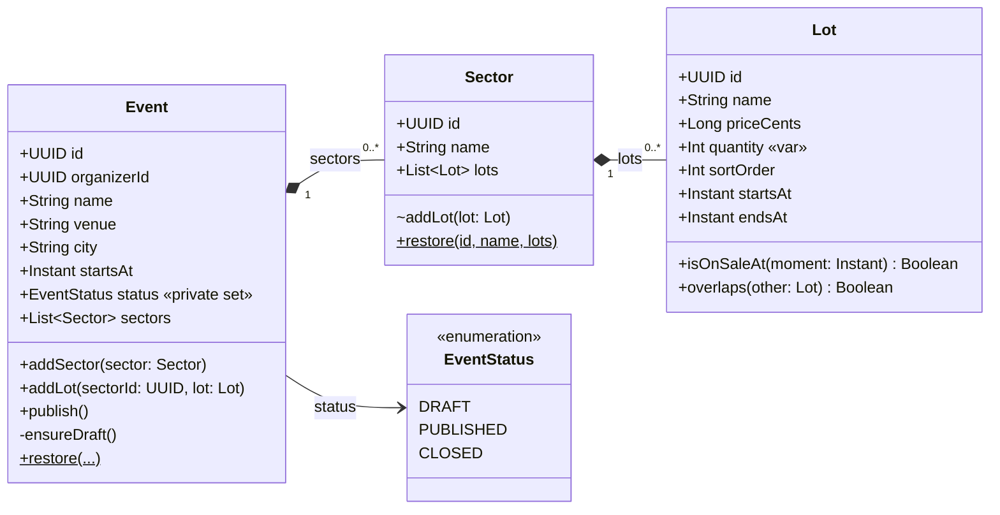
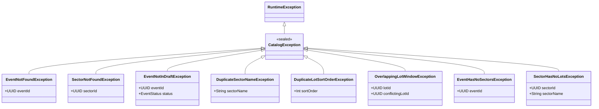
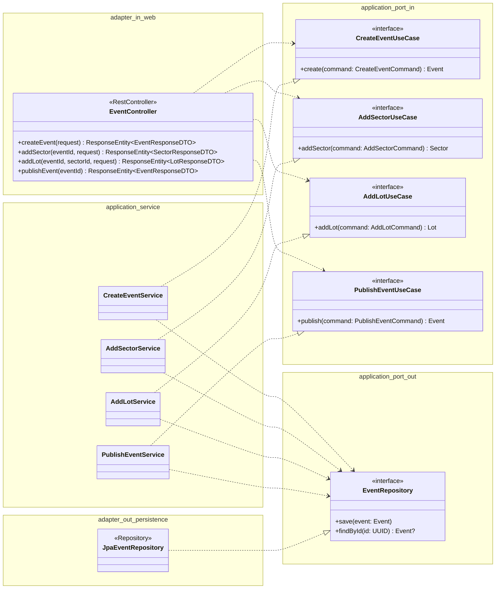
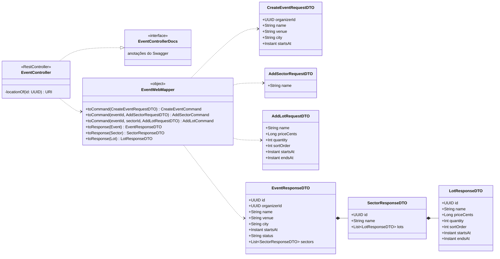
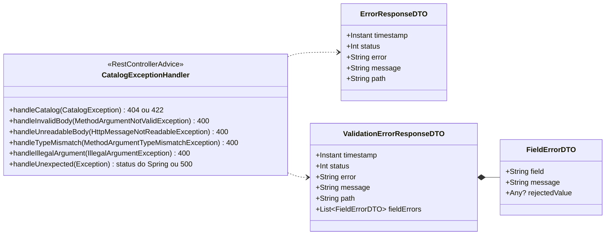
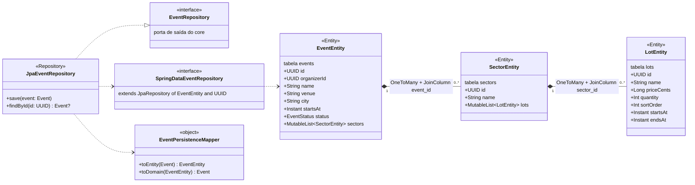

# Catálogo — diagramas de classes

> Estado do código em 2026-11-10 (branch `feat/catalog`). Pacote base: `com.reynanfc.ticketrush.catalog`.
> Quando uma classe mudar, atualize o diagrama no mesmo PR.

O módulo está dividido em quatro diagramas, do centro para fora do hexágono:

1. [Domínio](#1-domínio) — as regras de negócio.
2. [Visão hexagonal](#2-visão-hexagonal) — portas, casos de uso e adapters ligados.
3. [Adapter web](#3-adapter-web) — DTOs, mapper e tratamento de erros.
4. [Adapter de persistência](#4-adapter-de-persistência) — entidades JPA e mapper.

Legenda: `+` público, `-` privado, `~` internal, `$` no fim = estático (`companion object`). `*--` composição (a parte não existe sem o todo), `..|>` implementa, `..>` depende de / usa.

---

## 1. Domínio

`Event` é o aggregate root: setores e lotes só mudam através dele. Nada aqui conhece Spring, JPA ou HTTP.

Regras de cada classe:

| Classe | Regras |
|---|---|
| `Event` | `addSector`, `addLot` e `publish` só em DRAFT. Nome de setor único. `publish` exige setores, e cada setor precisa de pelo menos um lote. |
| `Sector` | `addLot` é `internal`: lotes entram pelo `Event`. `sortOrder` único e janelas de venda sem sobreposição. |
| `Lot` | Janela `[startsAt, endsAt)`. `init` valida nome, quantidade > 0, preço >= 0 e `endsAt > startsAt`. |

### Exceções do domínio

`CatalogException` é `sealed`: o `when` no `CatalogExceptionHandler` é exaustivo.

| HTTP | Exceções |
|---|---|
| 404 | `EventNotFoundException`, `SectorNotFoundException` |
| 422 | todas as outras |

---

## 2. Visão hexagonal

A estrutura do módulo. As setas de dependência sempre apontam **para dentro** (para o core). O core define as portas, e os adapters as implementam (porta de saída) ou as chamam (porta de entrada).

Como ler:

- **Porta de entrada** (`port/in`): o que o catálogo oferece. Implementada pelos services e chamada pelo controller, que só conhece a interface.
- **Porta de saída** (`port/out`): o que o catálogo precisa. Chamada pelos services e implementada pelo adapter JPA.
- Os services não têm `@Service`. O `CatalogConfiguration` (`@Configuration`) cria cada um como `@Bean` e devolve a interface do use case.
- Os commands (`CreateEventCommand`, `AddSectorCommand`, `AddLotCommand`, `PublishEventCommand`) são `data class` em `port/in/command`. Eles carregam os dados e o "endereço" (`eventId`, `sectorId`), sem `id` nem `status`.

---

## 3. Adapter web

O controller só cuida do HTTP. A tradução fica no `EventWebMapper`, e os erros, no `CatalogExceptionHandler`.

### Erros

---

## 4. Adapter de persistência

As entidades JPA são separadas do domínio. O `EventPersistenceMapper` traduz nos dois sentidos, e a volta usa `restore` para não repetir as regras de negócio.

Os relacionamentos são `@OneToMany` unidirecionais com `cascade = ALL` e `orphanRemoval = true`. Salvar o `EventEntity` salva a árvore inteira, do mesmo jeito que o aggregate é salvo inteiro pela porta.
